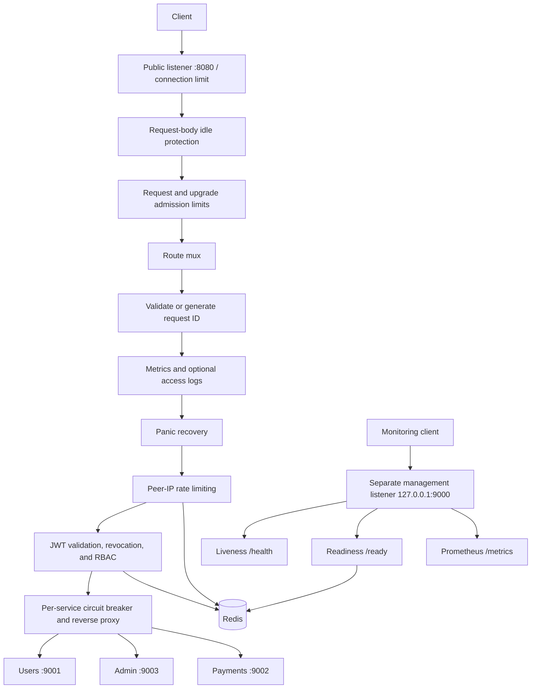

# SecureGate — Go Reverse Proxy

SecureGate forwards HTTP requests to configured upstream services, with bounded connections, streaming support, circuit breakers, and isolated management endpoints. The current implementation also includes mandatory JWT authorization and Redis-backed rate limiting and revocation checks.

The project is moving toward a lightweight, reverse-proxy-only core. Authentication extraction, backend pools, and comparative performance benchmarks remain future work; this repository does not yet establish a performance advantage over nginx.

---

## Features

| Feature | Details |
|---|---|
| **JWT Authentication** | HS256 only; required expiration, issuer, audience, and nonempty token ID (`jti`) |
| **RBAC Authorization** | Decoded route-segment matching with USER / ADMIN roles |
| **Revocation checks** | Existing Redis revocations are enforced; lookup failures return 503. Token management belongs to an external identity service. |
| **Redis Rate Limiting** | Atomic Lua script; per-client IP window (configurable) |
| **Circuit Breaker** | Per-service CLOSED → OPEN → HALF_OPEN state machine; 503 on open |
| **X-Request-ID** | Validated or generated on middleware-handled requests; echoed and forwarded |
| **Structured Logging** | Opt-in JSON access logs, normalized route/method fields, bounded string values |
| **Prometheus Metrics** | Request count, latency histogram, rate-limit blocks, auth failures |
| **Observability stack** | Compose starts Prometheus and Grafana; scraping connectivity and dashboards require setup |
| **Health Endpoints** | Private management listener: `/health` for liveness, `/ready` for Redis readiness |
| **Graceful Shutdown** | SIGINT/SIGTERM handled; configurable drain budget (10 seconds by default) |
| **Resource controls** | Configurable connection/request limits, upload idle timeout, and a separate upgrade budget |
| **Panic Recovery** | 500 before response commitment; interrupted responses are aborted without appending error text |

---

## Architecture



Public `/metrics`, `/health`, and `/ready` return 404. The retired public `/auth/revoke` also returns 404 without reading its body. These reserved paths bypass the protected-route middleware chain. Management has separate connection and request budgets.

Circuit breakers open after five consecutive counted failures and allow one recovery probe after a 30-second cooldown. Client cancellations do not count as upstream failures; stale completions cannot close a newly opened breaker. Response middleware preserves flushing and connection upgrades.

---

## Project Structure

```
SecureGate/
├── cmd/
│   ├── gateway/          # Proxy :8080 and management 127.0.0.1:9000
│   ├── userservice/      # Sample user service (port 9001)
│   ├── adminservice/     # Sample admin service (port 9003)
│   ├── paymentsservice/  # Sample payments service (port 9002)
│   └── token/            # JWT token generator CLI
├── internal/
│   ├── auth/             # RBAC route→role map
│   ├── circuitbreaker/   # Thread-safe circuit breaker
│   ├── config/           # Validated environment and resource settings
│   ├── httpio/           # Connection bounds, body idle protection, response recorder
│   ├── logging/          # Bounded structured logging
│   ├── metrics/          # Prometheus metric definitions
│   ├── middlewares/      # Auth, rate limit, metrics, recovery, request-ID
│   ├── proxy/            # Reverse proxy with circuit breaker integration
│   ├── ratelimit/        # Bounded Redis client, Lua rate limiter, revocation checks
│   └── routing/          # Shared route-segment matching
├── configs/
│   └── prometheus.yml
├── .github/workflows/
│   └── ci.yml            # CI: vet, race tests, binary and image builds
├── docker-compose.yml    # Redis, Prometheus, Grafana
├── Dockerfile            # Go builder → non-root scratch runtime
├── .dockerignore        # Restricts the image build context
└── Makefile
```

---

## Environment Variables

| Variable | Default | Description |
|---|---|---|
| `JWT_SECRET` | *(required)* | HMAC secret for JWT signing and validation |
| `JWT_ISSUER` | `securegate` | Required token issuer (`iss`), exact match |
| `JWT_AUDIENCE` | `securegate-api` | Required token audience (`aud`), string or array containing this value |
| `REDIS_ADDR` | `127.0.0.1:6379` | Redis `host:port` address |
| `RATE_LIMIT_COUNT` | `5` | Positive integer; max requests per window per IP |
| `RATE_LIMIT_WINDOW_SECONDS` | `10` | Integer window size, 1–9223372036 seconds |
| `USER_SERVICE_ADDR` | `http://localhost:9001` | User service base URL |
| `ADMIN_SERVICE_ADDR` | `http://localhost:9003` | Admin service base URL |
| `PAYMENTS_SERVICE_ADDR` | `http://localhost:9002` | Payments service base URL |
| `ACCESS_LOG_ENABLED` | `false` | Enable per-request JSON access logs; metrics remain enabled |
| `MANAGEMENT_ADDR` | `127.0.0.1:9000` | Separate management listener; restrict network access when overriding |
| `GATEWAY_PORT` | `:8080` | Listen address, `host:port` or `:port` |

Configuration is validated before Redis initialization or opening the gateway listener. Invalid values stop startup with an error naming the setting. Missing or empty optional environment variables use the defaults above; whitespace-only JWT settings and malformed numeric settings are rejected. `JWT_SECRET` must be nonblank. Defaults no longer hide numeric typos, and duration overflow is rejected.

Upstreams require absolute `http://` or `https://` URLs with a hostname or IP address. Base paths and query strings are supported; embedded credentials and fragments are rejected. Explicit ports must be numeric and between 1 and 65535, including Redis and listener ports. Bracket IPv6 addresses, for example `http://[::1]:9001` and `[::]:8080`. Configuration validation checks syntax; DNS resolution and service availability are checked at runtime.

A missing `.env` file is allowed. An existing unreadable or malformed file stops startup (including the token CLI), even when environment variables are present. Environment variables take precedence over `.env`; errors omit configuration values to avoid disclosing secrets.

Create a `.env` file in the project root (see example below):

```env
JWT_SECRET=your_ultra_secure_secret_key
REDIS_ADDR=127.0.0.1:6379
```

---

## Redis operation limits

Rate-limit, revocation, and readiness operations inherit request contexts and have a 500 ms deadline. Redis socket reads, writes, and dialing also have 500 ms limits; pool waits are limited to 100 ms. Automatic retries are disabled and the pool is capped at 32 connections. Cancellation propagates to Redis; an already-blocked socket operation remains bounded by its deadline. Store failures deny protected requests with 503. Startup checks Redis within the same deadline and shutdown closes the client.

## Resource limits

Settings are read once at startup; restart to apply changes. Capacities must be positive integers (at most 1,000,000; header size at most 1 MiB). Timeouts are integer seconds between 1 and 86400, except `REQUEST_TIMEOUT_SECONDS`, which also accepts zero.

| Setting | Default | Purpose |
|---|---|---|
| `MAX_CONNECTIONS` | `1024` | Public accepted sockets, including idle and upgraded connections |
| `MAX_REQUESTS` | `256` | All concurrent public requests, including streams |
| `MAX_UPGRADE_REQUESTS` | `32` | Additional smaller budget for upgrade requests; must not exceed `MAX_REQUESTS` |
| `MAX_UPSTREAM_CONNECTIONS` | `128` | Connections per upstream host |
| `MAX_HEADER_BYTES` | `65536` | Client request and upstream response header limits |
| `HEADER_TIMEOUT_SECONDS` | `5` | Complete client request headers |
| `REQUEST_TIMEOUT_SECONDS` | `30` | Complete client request including body; zero disables this total deadline |
| `CLIENT_READ_IDLE_SECONDS` | `30` | Maximum wait for an individual request-body read |
| `CLIENT_WRITE_TIMEOUT_SECONDS` | `30` | Maximum wait for a client socket write |
| `KEEPALIVE_TIMEOUT_SECONDS` | `60` | HTTP keep-alive idle timeout |
| `UPSTREAM_DIAL_TIMEOUT_SECONDS` | `5` | Upstream connection establishment |
| `UPSTREAM_HEADER_TIMEOUT_SECONDS` | `15` | Wait for upstream response headers |
| `UPSTREAM_READ_IDLE_SECONDS` | `60` | Maximum wait for an upstream body read, including upgrades |
| `SHUTDOWN_TIMEOUT_SECONDS` | `10` | Graceful shutdown budget |

For long uploads, set `REQUEST_TIMEOUT_SECONDS=0` (or a larger total deadline). Client read-idle protection remains enabled; uploads must continue making progress. SSE and other responses have no total response-duration cap, but reads and writes must progress within their configured timeouts. Upgraded connections count against both admission budgets until they close; idle upgraded connections expire under the upstream read limit. SSE streams share the main request budget. Management limits remain separately fixed at 32 sockets and 8 requests, with two scrapes and two readiness checks at a time.

Shutdown drains ordinary requests within `SHUTDOWN_TIMEOUT_SECONDS`, then closes remaining sockets, including upgraded connections. Redis and idle upstream connections are closed on exit.

---

## Setup and Run

Prerequisites: Go 1.25.6 or newer, Docker with Compose for the local Redis stack, and a `.env` containing a nonblank `JWT_SECRET` as shown above. Use a randomly generated secret for your deployment.

### 1. Clone

```bash
git clone https://github.com/whilstsomebody/securegate.git
cd securegate
```

### 2. Start Redis

```bash
docker compose up -d redis
```

Redis is published on `127.0.0.1:6379`. For the optional monitoring stack, see [Monitoring](#monitoring); `make docker-up` starts all three Compose services but does not make the private management listener reachable from containers.

### 3. Start backend microservices

```bash
go run ./cmd/userservice &
go run ./cmd/adminservice &
go run ./cmd/paymentsservice &
```

### 4. Run the gateway

```bash
make run
# or: go run ./cmd/gateway
```

Gateway is live at `http://localhost:8080`.

---

## Makefile Targets

```bash
make run          # run the gateway
make build        # compile to bin/gateway
make test         # go test ./...
make lint         # go vet ./...
make services     # start the three sample upstream services
make token        # generate a USER token  (ROLE=ADMIN for admin token)
make docker-up    # start Redis + Prometheus + Grafana
make docker-down  # stop containers
```

---

## Management endpoints

`/metrics`, `/health`, and `/ready` are served only on `MANAGEMENT_ADDR` (default `127.0.0.1:9000`); the public proxy returns 404 for these paths. `/health` is process liveness and never calls Redis. `/ready` checks Redis within 500 ms, with at most two concurrent checks. Management has its own 32-connection and 8-request limits; scrapes are limited to two concurrent requests. Only GET and HEAD are accepted.

Update monitoring and probes to port 9000. Docker-hosted Prometheus needs an explicitly reachable management bind address and firewall restrictions; the default loopback bind is intentionally private. These endpoints have no application authentication, so expose them only to your monitoring network.

## Usage

### Generate a JWT token

Tokens must use HS256 and include a valid `exp`, matching `iss` and `aud`, a nonblank string `jti`, and the route’s required `role`. Every accepted token undergoes a revocation lookup; unavailable Redis fails closed. The CLI uses the same issuer and audience settings as the gateway.

**Compatibility:** older tokens without issuer or audience are rejected. Regenerate them with the CLI below, or update your issuer to supply these claims.

```bash
make token              # USER token
make token ROLE=ADMIN   # ADMIN token
```

Copy the printed token.

### Call a protected route

```bash
curl -H "Authorization: Bearer <USER_TOKEN>" http://localhost:8080/users/hello
curl -H "Authorization: Bearer <ADMIN_TOKEN>" http://localhost:8080/admin/dashboard
curl -H "Authorization: Bearer <ADMIN_TOKEN>" http://localhost:8080/payments/checkout
```

### Health check

```bash
curl http://localhost:9000/health
# {"status":"ok"}
curl http://localhost:9000/ready
# {"status":"ok","redis":"ok"}
```

### Token management

The public `/auth/revoke` endpoint has been removed and returns 404. It must not be used to manage tokens. Existing revocation entries remain enforced; unavailable revocation storage returns 503. Token issuance and revocation should move to a separate identity service as the reverse-proxy core is extracted.

Client identity for rate limiting comes from the TCP peer. Incoming `X-Forwarded-For` and `X-Real-IP` are not trusted. Deployments behind another proxy therefore share that proxy's rate-limit allowance until explicit trusted-proxy configuration is added.

### Rate limiting

```bash
for i in {1..10}; do
  curl -s -o /dev/null -w "%{http_code}\n" \
    -H "Authorization: Bearer <TOKEN>" \
    http://localhost:8080/users/hello
done
# With a valid USER token and a fresh window: five 200 responses, then 429.
```

---

## Route → Role Map

| Path prefix | Required role | Backend |
|---|---|---|
| `/users` and `/users/...` | USER | port 9001 |
| `/admin` and `/admin/...` | ADMIN | port 9003 |
| `/payments` and `/payments/...` | ADMIN | port 9002 |
| `/metrics` | *(management listener only)* | Prometheus scrape |
| `/health` | *(management listener only)* | Process liveness |
| `/ready` | *(management listener only)* | Redis readiness |

---

Routing matches decoded path segments: `/users` and `/users/...` select the users service, while `/usersanything` does not. Forwarding, authorization, circuit selection, and metric labels use the same route boundary rule.

The proxy removes the mount and its separating slash, then preserves escapes in the remaining path. For example, `/users/a%2Fb` is forwarded as `/a%2Fb`, not `/a/b`. Encoded mount names and separators are accepted consistently: `/%75sers%2Fa%2Fb` also becomes `/a%2Fb`. Upstream base paths are prepended without decoding escaped suffixes. The incoming URL remains unchanged; access logs use its normalized route label.

The gateway's outer Go `ServeMux` still applies its normal redirects for literal dot segments and repeated slashes before forwarding; this change does not disable that behavior.

## Monitoring

| Metric | Type | Labels |
|---|---|---|
| `securegate_requests_total` | Counter | path, method, status |
| `securegate_request_duration_seconds` | Histogram | path |
| `securegate_rate_limited_total` | Counter | path |
| `securegate_auth_failures_total` | Counter | path, reason |
| `securegate_response_aborts_total` | Counter | path |

Metric `path` values for protected traffic are bounded route labels (`/users`, `/payments`, `/admin`, or `unmatched`), never raw URLs. Nonstandard methods use `OTHER`. Request counters and latency include authentication failures, rate-limit rejections, and aborted responses that reach the metrics middleware. Admission rejections, reserved public paths, and management requests occur outside that middleware and are not included. `securegate_response_aborts_total` identifies interrupted responses even when 200 headers were already sent.

Start the optional services with `docker compose up -d prometheus grafana`. The supplied scrape configuration targets `host.docker.internal:9000`; a host-run gateway bound only to loopback is not reachable through that address. For container scraping, explicitly bind management to an interface reachable from Docker and restrict access to the monitoring network. Use the private default when scraping from the host.

Grafana is started without provisioned dashboards or data sources. Add a Prometheus data source at `http://prometheus:9090` in Grafana and create or import a dashboard.

- Prometheus UI: `http://localhost:9090`
- Metrics endpoint: `http://localhost:9000/metrics`
- Grafana UI: `http://localhost:3000`


---

## Request IDs and logging

Incoming request IDs are accepted only as a single header value of 1–128 ASCII letters, digits, `.`, `_`, `:`, or `-`; all other IDs are replaced with a generated ID before forwarding and echoing. IDs are correlation labels, not trusted identities.

Access logs are disabled by default; set `ACCESS_LOG_ENABLED=true` to enable synchronous JSON request logging. Request logs identify the route and normalized method rather than the full URL. Metrics remain enabled regardless. Routine 403/429 outcomes are counted in metrics without warning logs; operational failures remain logged. Structured string/error values are truncated after 1024 bytes to bound individual log records. Slow log sinks can still delay requests when logging is enabled.

## Docker Build

The example below connects a containerized gateway to Compose Redis and the sample services running on the host. Start the sample services first and provide your JWT settings in `.env`.

```bash
docker compose -p securegate up -d redis
docker build -t securegate .
docker run --rm --name securegate-gateway \
  --network securegate_default --add-host host.docker.internal:host-gateway \
  --read-only --cap-drop=ALL --security-opt=no-new-privileges:true \
  -p 8080:8080 -p 127.0.0.1:9000:9000 --env-file .env \
  -e REDIS_ADDR=redis:6379 \
  -e USER_SERVICE_ADDR=http://host.docker.internal:9001 \
  -e ADMIN_SERVICE_ADDR=http://host.docker.internal:9003 \
  -e PAYMENTS_SERVICE_ADDR=http://host.docker.internal:9002 \
  -e MANAGEMENT_ADDR=0.0.0.0:9000 securegate
```

Stop a host-run gateway before using the same published ports. The host services must accept connections from Docker. For upstreams running in containers, use their service names on a shared Docker network instead. Stop this example's Redis stack with `docker compose -p securegate down`.

### Container deployment notes

The gateway builds with Go 1.25.6 (matching `go.mod`), with automatic toolchain downloads disabled in the builder. CI selects Go from `go.mod`, runs race tests, and builds the container. The final image contains the static gateway binary and CA certificates for HTTPS upstream verification, runs as UID/GID 65532, and supports a read-only filesystem. The build context excludes `.env`, Git metadata, tests, and unrelated project files. No runtime configuration secrets are baked into the image.

The Compose file is a local development stack: Redis, Prometheus, and Grafana host ports bind only to `127.0.0.1`. Prometheus configuration is mounted read-only. Set Redis and backend URLs to addresses reachable from the gateway container; `localhost` inside a container refers to that container. For management access through a published container port, explicitly set `MANAGEMENT_ADDR=0.0.0.0:9000` and publish only to a trusted interface (for local access, `-p 127.0.0.1:9000:9000`). Host-run gateways keep the private loopback management default; Docker-hosted Prometheus needs a reachable bind address restricted to your monitoring network.

---

## Running Tests

```bash
make test
go test -race ./... -timeout 60s
make lint
docker compose --env-file /dev/null config --quiet
```

Tests cover JWT policy and revocation failures, peer-based rate limiting, Redis cancellation/deadlines, management isolation, bounded IDs/logging, resource configuration, upload and streaming timeouts, admission limits, circuit breakers, response integrity, escaped routing, and RBAC. No live Redis is required for the Go test suite.

## Upgrade checklist

- Regenerate tokens missing `iss`, `aud`, `exp`, or a nonblank string `jti`; only HS256 is accepted.
- Move scrape and probe URLs from public port 8080 to the management listener. Use `/health` for liveness and `/ready` for Redis readiness.
- Set `ACCESS_LOG_ENABLED=true` if you need per-request logs; operational error logs and metrics remain enabled.
- Correct malformed configuration before restarting. Invalid numeric settings and unreadable/malformed `.env` files now stop startup.
- For uploads longer than 30 seconds, increase `REQUEST_TIMEOUT_SECONDS` or set it to zero; keep request-body idle protection enabled.
- Remove clients of `/auth/revoke`; revocation writes belong to your identity service.

## Remaining work

JWT/RBAC and Redis are still required, and each route has one upstream. Moving those policies out of the proxy core, building reusable route handlers, supporting backend pools, and adding comparative load benchmarks remain planned work. The public listener currently serves HTTP; deployments requiring TLS termination need to provide it separately. Runtime settings are loaded once; configuration reload is not implemented.
