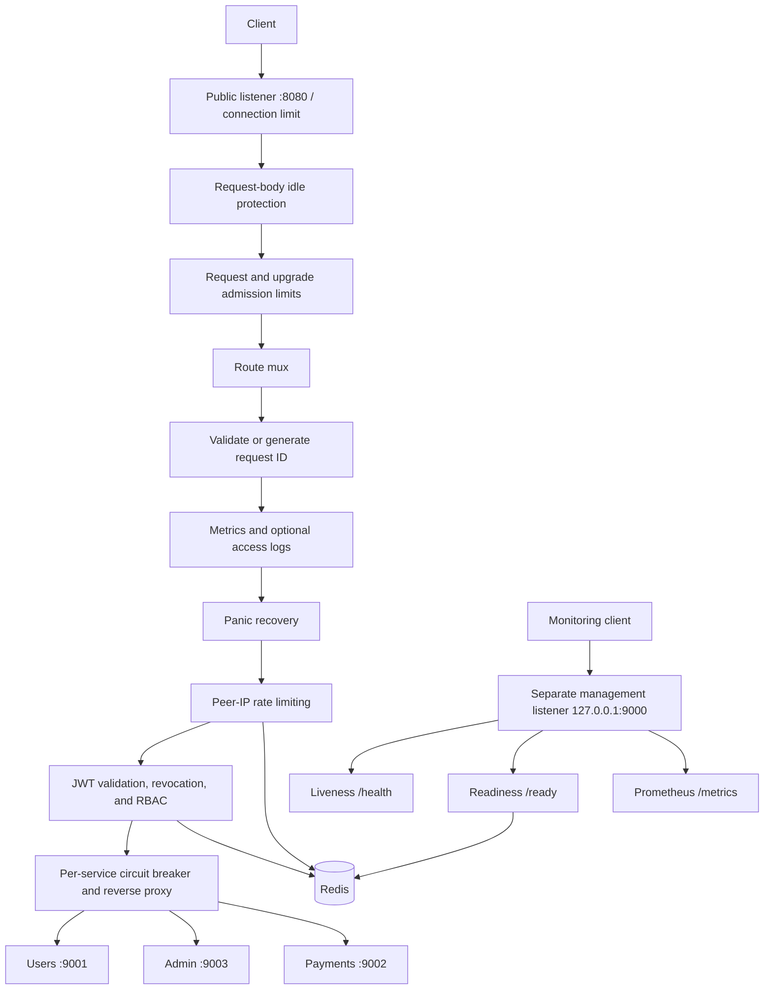

# SecureGate — Go Reverse Proxy

SecureGate forwards HTTP requests to configured upstream services, with bounded connections, streaming support, circuit breakers, and isolated management endpoints. JWT authorization and Redis-backed rate limiting and revocation checks are optional policies.

The proxy core can run without those policies. This repository includes a reproducible nginx comparison harness, but does not make a universal performance claim: results depend on the workload and host.

---

## Features

| Feature | Details |
|---|---|
| **One-Command Demo** | Single command demo with gateway, Redis, 3 backends, Prometheus, and Grafana (`make demo` or `make docker-demo`) |
| **Config Validation** | Pre-flight configuration checker without starting listeners or connecting to Redis (`make check-config` / `-t`) |
| **JWT Authentication** | HS256 only; required expiration, issuer, audience, and nonempty token ID (`jti`) |
| **RBAC Authorization** | Decoded route-segment matching with USER / ADMIN roles |
| **Revocation checks** | Existing Redis revocations are enforced; lookup failures return 503 with `Retry-After: 5` |
| **Redis Rate Limiting** | Atomic Lua script; per-client IP window with `429 Too Many Requests` and `Retry-After` header |
| **Circuit Breaker** | Per-service CLOSED → OPEN → HALF_OPEN state machine; `503 Service Unavailable` with `Retry-After: 30` on open |
| **Standardized JSON Errors** | Consistent structured error envelope (`code`, `message`, `status`, `request_id`) across all middleware and proxy failures |
| **X-Request-ID** | Validated or generated on middleware-handled requests; echoed in response and error envelopes |
| **Structured Logging** | Opt-in JSON access logs, normalized route/method fields, bounded string values |
| **Prometheus Metrics** | 15 operational metrics covering request rate, latency, backend health and load, active sockets/requests/upgrades, admission rejections, timeouts, and breaker states |
| **Grafana Provisioning** | Auto-provisioned Prometheus datasource and comprehensive "SecureGate Overview" dashboard |
| **Health Endpoints** | Private management listener: `/health` for liveness, `/ready` for Redis readiness |
| **Graceful Shutdown** | SIGINT/SIGTERM handled; configurable drain budget (10 seconds by default) |
| **Resource controls** | Configurable connection/request limits, upload idle timeout, and a separate upgrade budget |
| **Panic Recovery** | 500 before response commitment; interrupted responses are aborted without appending error text |
| **Integration & Smoke Tests**| Real Redis integration test suite (`make test-integration`) and end-to-end operational smoke tests (`make smoke`) |
| **Release Pipeline** | Versioned multi-platform cross-compilation with SHA256 checksums (`make release`) |
| **nginx Comparison** | Reproducible, alternating-round proxy benchmark against the same upstream (`make benchmark`) |

---

## Architecture



Public `/metrics`, `/health`, and `/ready` return 404. The retired public `/auth/revoke` also returns 404 without reading its body. These reserved paths bypass the protected-route middleware chain. Management has separate connection and request budgets.

Circuit breakers open after five consecutive counted failures and allow one recovery probe after a 30-second cooldown. Client cancellations do not count as upstream failures; stale completions cannot close a newly opened breaker. Response middleware preserves flushing and connection upgrades.

---

## Project Structure

```
SecureGate/
├── cmd/
│   ├── gateway/          # Proxy :8080 and management 127.0.0.1:9000
│   ├── userservice/      # Sample user service (port 9001)
│   ├── adminservice/     # Sample admin service (port 9003)
│   ├── paymentsservice/  # Sample payments service (port 9002)
│   ├── token/            # JWT token generator CLI
│   └── benchmark/        # Self-contained HTTP benchmark runner
├── benchmarks/           # Equal-workload nginx comparison stack and saved JSON results
├── internal/
│   ├── auth/             # JWT-related helpers
│   ├── circuitbreaker/   # Thread-safe circuit breaker
│   ├── config/           # Validated environment, route-file, and resource settings
│   ├── httpio/           # Connection bounds, body idle protection, standardized errors
│   ├── logging/          # Bounded structured logging
│   ├── metrics/          # Prometheus metric definitions
│   ├── middlewares/      # Auth, rate limit, metrics, recovery, admission, request-ID
│   ├── proxy/            # Reverse proxy with circuit breaker integration
│   ├── ratelimit/        # Bounded Redis client, Lua rate limiter, revocation checks
│   ├── routing/          # Immutable route tables and segment matching
│   └── version/          # Version metadata and runtime build info
├── configs/
│   ├── grafana/          # Auto-provisioned datasource and overview dashboard
│   ├── prometheus.yml    # Development Prometheus scrape config
│   └── prometheus.demo.yml # Containerized demo Prometheus scrape config
├── scripts/
│   ├── benchmark.sh      # Comparison-stack orchestration and Docker resource sampling
│   ├── demo.sh           # One-command host demo stack runner
│   ├── release.sh        # Multi-platform release compilation & checksums
│   └── smoke_test.sh     # Operational live smoke test runner
├── test/
│   ├── integration/      # Real Redis integration test suite
│   └── smoke/            # End-to-end operational smoke tests
├── .github/workflows/
│   └── ci.yml            # CI: vet, race tests, Redis integration, image builds
├── docker-compose.yml    # Redis, Prometheus, Grafana
├── docker-compose.demo.yml # All-in-one containerized demo stack
├── Dockerfile            # Go builder → non-root scratch runtime
├── .dockerignore         # Restricts the image build context
└── Makefile              # Developer tasks and operational commands
```

---

## Environment Variables

| Variable | Default | Description |
|---|---|---|
| `JWT_SECRET` | *(required when `AUTH_ENABLED=true`)* | HMAC secret for JWT signing and validation |
| `JWT_ISSUER` | `securegate` | Required token issuer (`iss`), exact match |
| `JWT_AUDIENCE` | `securegate-api` | Required token audience (`aud`), string or array containing this value |
| `AUTH_ENABLED` | `true` | Apply JWT, revocation, and RBAC middleware; set `false` for proxy-only mode |
| `REDIS_ADDR` | `127.0.0.1:6379` | Redis `host:port` address (required when auth or rate limiting is enabled) |
| `RATE_LIMIT_ENABLED` | `true` | Apply Redis-backed peer-IP rate limiting |
| `RATE_LIMIT_COUNT` | `5` | Positive integer; max requests per window per IP |
| `RATE_LIMIT_WINDOW_SECONDS` | `10` | Integer window size, 1–9223372036 seconds |
| `ROUTES_FILE` | *(unset)* | JSON route file; when set, replaces the three legacy upstream settings and can be reloaded with `SIGHUP` |
| `USER_SERVICE_ADDR` | `http://localhost:9001` | Legacy `/users` service base URL, used only when `ROUTES_FILE` is unset |
| `ADMIN_SERVICE_ADDR` | `http://localhost:9003` | Legacy `/admin` service base URL, used only when `ROUTES_FILE` is unset |
| `PAYMENTS_SERVICE_ADDR` | `http://localhost:9002` | Legacy `/payments` service base URL, used only when `ROUTES_FILE` is unset |
| `ACCESS_LOG_ENABLED` | `false` | Enable per-request JSON access logs; metrics remain enabled |
| `TRUSTED_PROXY_CIDRS` | *(unset)* | Comma-separated canonical CIDRs allowed to supply `X-Forwarded-For`; unset means no forwarding headers are trusted |
| `TLS_CERT_FILE` | *(unset)* | PEM certificate chain for HTTPS termination; requires `TLS_KEY_FILE` |
| `TLS_KEY_FILE` | *(unset)* | PEM private key for HTTPS termination; requires `TLS_CERT_FILE` |
| `MANAGEMENT_ADDR` | `127.0.0.1:9000` | Separate management listener; restrict network access when overriding |
| `GATEWAY_PORT` | `:8080` | Listen address, `host:port` or `:port` |

Configuration is validated before Redis initialization or opening the gateway listener. Invalid values stop startup with an error naming the setting. Missing or empty optional environment variables use the defaults above; whitespace-only enabled JWT settings and malformed numeric settings are rejected. Defaults no longer hide numeric typos, and duration overflow is rejected.

For proxy-only operation, set both `AUTH_ENABLED=false` and `RATE_LIMIT_ENABLED=false`. In that mode SecureGate does not require `JWT_SECRET`, does not connect to Redis, and reports readiness with `"redis":"disabled"`. Disabling only one policy keeps Redis required for the other. The default remains both policies enabled for backward compatibility.

Upstreams require absolute `http://` or `https://` URLs with a hostname or IP address. Base paths and query strings are supported; embedded credentials and fragments are rejected. Explicit ports must be numeric and between 1 and 65535, including Redis and listener ports. Bracket IPv6 addresses, for example `http://[::1]:9001` and `[::]:8080`. Configuration validation checks syntax; DNS resolution and service availability are checked at runtime.

### Dynamic routes and zero-downtime reload

Set `ROUTES_FILE` to a JSON document containing every public route:

```json
{
  "routes": [
    {
      "prefix": "/catalog",
      "backends": ["http://catalog-a:8080", "http://catalog-b:8080"],
      "balance": "least_connections",
      "health_check_path": "/healthz",
      "health_check_interval_seconds": 5,
      "role": "USER"
    },
    {"prefix": "/billing/v1", "target": "http://billing:8080", "role": "ADMIN"}
  ]
}
```

Prefixes are decoded, segment-safe mounts: they must start with `/`, cannot be `/` or end in `/`, and cannot contain empty, `.` or `..` segments. The longest matching mount is selected, so `/catalog/admin` can safely coexist with `/catalog`. Every prefix must be unique and every backend follows the upstream URL rules above. When `AUTH_ENABLED=true`, every route must specify a role.

For backward compatibility, a route can still use one `target`. A route must use either `target` or a non-empty `backends` list. Pools default to `round_robin`; set `balance` to `least_connections` to send each request to the eligible backend with the fewest active requests. Explicit pools receive immediate and periodic `GET` checks (default path `/health`, default interval 5 seconds); only `2xx` and `3xx` responses are healthy. A route with a single `target` keeps its existing passive behavior unless a health-check path or interval is set. Failed checks and open per-backend circuit breakers remove a backend from selection. During reload, the previous pool drains: it accepts no new selections but lets assigned requests finish before its health workers stop.

After atomically replacing the file, send the gateway `SIGHUP` (`kill -HUP <pid>`). SecureGate reads and validates the full file, builds a complete replacement handler, and swaps it only if validation succeeds. Existing requests keep the route set they started with; new requests use the new set. A failed reload is logged and leaves the active routes unchanged. Route reload changes forwarding, RBAC, rate-limit labels, access-log labels, and proxy metrics together. Listener, TLS, Redis, and timeout settings still require a restart.

A missing `.env` file is allowed. An existing unreadable or malformed file stops startup (including the token CLI), even when environment variables are present. Environment variables take precedence over `.env`; errors omit configuration values to avoid disclosing secrets.

Create a `.env` file in the project root (see example below):

```env
JWT_SECRET=your_ultra_secure_secret_key
REDIS_ADDR=127.0.0.1:6379
```

---

## Redis operation limits

Rate-limit, revocation, and readiness operations inherit request contexts and have a 500 ms deadline. Redis socket reads, writes, and dialing also have 500 ms limits; pool waits are limited to 100 ms. Automatic retries are disabled and the pool is capped at 32 connections. Cancellation propagates to Redis; an already-blocked socket operation remains bounded by its deadline. Store failures deny protected requests with 503. Startup checks Redis within the same deadline and shutdown closes the client.

## Resource limits

Settings are read once at startup; restart to apply changes. Capacities must be positive integers (at most 1,000,000; header size at most 1 MiB). Timeouts are integer seconds between 1 and 86400, except `REQUEST_TIMEOUT_SECONDS`, which also accepts zero.

| Setting | Default | Purpose |
|---|---|---|
| `MAX_CONNECTIONS` | `1024` | Public accepted sockets, including idle and upgraded connections |
| `MAX_REQUESTS` | `256` | All concurrent public requests, including streams |
| `MAX_UPGRADE_REQUESTS` | `32` | Additional smaller budget for upgrade requests; must not exceed `MAX_REQUESTS` |
| `MAX_UPSTREAM_CONNECTIONS` | `128` | Connections per upstream host |
| `MAX_HEADER_BYTES` | `65536` | Client request and upstream response header limits |
| `HEADER_TIMEOUT_SECONDS` | `5` | Complete client request headers |
| `REQUEST_TIMEOUT_SECONDS` | `30` | Complete client request including body; zero disables this total deadline |
| `CLIENT_READ_IDLE_SECONDS` | `30` | Maximum wait for an individual request-body read |
| `CLIENT_WRITE_TIMEOUT_SECONDS` | `30` | Maximum wait for a client socket write |
| `KEEPALIVE_TIMEOUT_SECONDS` | `60` | HTTP keep-alive idle timeout |
| `UPSTREAM_DIAL_TIMEOUT_SECONDS` | `5` | Upstream connection establishment |
| `UPSTREAM_HEADER_TIMEOUT_SECONDS` | `15` | Wait for upstream response headers |
| `UPSTREAM_READ_IDLE_SECONDS` | `60` | Maximum wait for an upstream body read, including upgrades |
| `SHUTDOWN_TIMEOUT_SECONDS` | `10` | Graceful shutdown budget |

For long uploads, set `REQUEST_TIMEOUT_SECONDS=0` (or a larger total deadline). Client read-idle protection remains enabled; uploads must continue making progress. SSE and other responses have no total response-duration cap, but reads and writes must progress within their configured timeouts. Upgraded connections count against both admission budgets until they close; idle upgraded connections expire under the upstream read limit. SSE streams share the main request budget. Management limits remain separately fixed at 32 sockets and 8 requests, with two scrapes and two readiness checks at a time.

Shutdown drains ordinary requests within `SHUTDOWN_TIMEOUT_SECONDS`, then closes remaining sockets, including upgraded connections. Redis and idle upstream connections are closed on exit.

---

## One-Command Demo

Start the full stack with a single command:

### Option A: Local Host Demo (`make demo`)

```bash
make demo
```

This single command:
1. Starts Redis, Prometheus, and Grafana via Docker (if Docker is available).
2. Starts the three sample upstream microservices (`userservice` on 9001, `adminservice` on 9003, `paymentsservice` on 9002).
3. Launches the SecureGate gateway on port `8080` (management on `127.0.0.1:9000`).
4. Generates demo USER and ADMIN tokens and prints test curl commands.
5. Pre-provisions the Grafana dashboard at `http://localhost:3000/d/securegate-overview`.
6. Gracefully shuts down all background processes when interrupted with `Ctrl+C`.

### Option B: 100% Containerized Demo (`make docker-demo`)

```bash
make docker-demo
# or: docker compose -f docker-compose.demo.yml up
```

Runs all 7 services (gateway, Redis, userservice, adminservice, paymentsservice, Prometheus, and Grafana) inside isolated Docker containers.

---

## Configuration Validation (`check-config`)

Verify configuration and resource limits syntax and semantics without starting listeners or attempting Redis connections:

```bash
# Via makefile:
make check-config

# Via gateway flag or subcommand:
./bin/gateway -check-config
./bin/gateway -t
./bin/gateway check-config
```

Example valid output:
```
configuration is valid (SecureGate v0.2.0)

Configuration syntax and values:
  Gateway Listen:       :8080
  Management Listen:    127.0.0.1:9000
  Redis Address:        127.0.0.1:6379
  Access Logging:       false
  Upstream Services:
    /users:             http://localhost:9001
    /admin:             http://localhost:9003
    /payments:          http://localhost:9002
  Rate Limiting:        5 requests / 10s per client IP
  JWT Policy:           issuer="securegate" audience="securegate-api" (secret configured: true)
  Resource Limits:
    Max Connections:    1024
    Max Requests:       256 (upgrades: 32)
    Max Upstream Conns: 128
...
```

Invalid configurations immediately exit with status `1` and explain the exact issue (e.g. `UPSTREAM_URL: must be an absolute HTTP(S) URL`).

---

## Comparative nginx benchmarks

Run the same request workload through SecureGate and nginx:

```bash
make benchmark
```

The isolated Compose stack starts one static upstream, then runs both proxies against `/users/hello`. Both forward the identical `/hello` request to that upstream. SecureGate runs in proxy-only mode, nginx uses a keep-alive upstream, and the built-in benchmark client uses the same connection limit for each target. It waits for readiness, warms each target, and runs alternating target order in every other round. The JSON result is saved to `benchmarks/results/comparison.json`; raw once-per-second Docker CPU, memory, network, block-I/O, and process samples are saved to `benchmarks/results/resources.jsonl`.

Adjust the workload without changing the benchmark definition:

```bash
BENCH_DURATION=30s BENCH_WARMUP=5s BENCH_CONCURRENCY=128 BENCH_ROUNDS=5 make benchmark
make benchmark-down
```

Each result records successful requests per second, errors, bytes, and successful-request p50/p95/p99 latency. Resource samples retain Docker's reported values without unit conversion. Run it on an otherwise idle, consistently resourced Docker host and compare multiple runs. The static upstream is intentionally a proxy-overhead measurement; it does not predict performance for TLS, dynamic responses, large bodies, upgrades, policy middleware, or a production network.

---

## Manual Setup and Run

Prerequisites: Go 1.25.6 or newer, Docker with Compose for the local Redis stack, and a `.env` containing a nonblank `JWT_SECRET` as shown above. Use a randomly generated secret for your deployment.

### 1. Clone

```bash
git clone https://github.com/whilstsomebody/securegate.git
cd securegate
```

### 2. Validate configuration

```bash
make check-config
```

### 3. Start Redis

```bash
docker compose up -d redis
```

Redis is published on `127.0.0.1:6379`. For the monitoring stack, see [Monitoring](#monitoring); `make docker-up` starts Redis, Prometheus, and Grafana with pre-provisioned dashboards.

### 4. Start backend microservices

```bash
go run ./cmd/userservice &
go run ./cmd/adminservice &
go run ./cmd/paymentsservice &
```

### 5. Run the gateway

```bash
make run
# or: go run ./cmd/gateway
```

Gateway is live at `http://localhost:8080`.

---

## Makefile Targets

```bash
make demo              # run one-command interactive demo on host
make docker-demo       # run all-in-one containerized demo stack
make check-config      # validate configuration without starting listeners
make version           # print version and build information
make run               # run the gateway on :8080
make build             # compile gateway to bin/gateway
make test              # run unit tests (go test ./...)
make test-integration  # run integration tests against real Redis
make smoke             # run operational smoke test suite
make smoke-live        # run live smoke script against running gateway
make release           # cross-compile versioned binaries and SHA256SUMS
make benchmark         # compare proxy-only SecureGate and nginx; writes JSON and resource samples
make benchmark-down    # stop and remove the benchmark Compose stack
make lint              # go vet ./...
make services          # start the three sample upstream services
make token             # generate a USER token (ROLE=ADMIN for admin token)
make docker-up         # start Redis + Prometheus + Grafana (pre-provisioned)
make docker-down       # stop containers
```

---

## Management endpoints

`/metrics`, `/health`, and `/ready` are served only on `MANAGEMENT_ADDR` (default `127.0.0.1:9000`); the public proxy returns 404 for these paths. `/health` is process liveness and never calls Redis. `/ready` checks Redis within 500 ms, with at most two concurrent checks. Management has its own 32-connection and 8-request limits; scrapes are limited to two concurrent requests. Only GET and HEAD are accepted.

Update monitoring and probes to port 9000. Docker-hosted Prometheus needs an explicitly reachable management bind address and firewall restrictions; the default loopback bind is intentionally private. These endpoints have no application authentication, so expose them only to your monitoring network.

## Usage

### Generate a JWT token

Tokens must use HS256 and include a valid `exp`, matching `iss` and `aud`, a nonblank string `jti`, and the route’s required `role`. Every accepted token undergoes a revocation lookup; unavailable Redis fails closed. The CLI uses the same issuer and audience settings as the gateway.

**Compatibility:** older tokens without issuer or audience are rejected. Regenerate them with the CLI below, or update your issuer to supply these claims.

```bash
make token              # USER token
make token ROLE=ADMIN   # ADMIN token
```

Copy the printed token.

### Call a protected route

```bash
curl -H "Authorization: Bearer <USER_TOKEN>" http://localhost:8080/users/hello
curl -H "Authorization: Bearer <ADMIN_TOKEN>" http://localhost:8080/admin/dashboard
curl -H "Authorization: Bearer <ADMIN_TOKEN>" http://localhost:8080/payments/checkout
```

### Health check

```bash
curl http://localhost:9000/health
# {"status":"ok"}
curl http://localhost:9000/ready
# {"status":"ok","redis":"ok"}
```

### Token management

The public `/auth/revoke` endpoint has been removed and returns 404. It must not be used to manage tokens. Existing revocation entries remain enforced; unavailable revocation storage returns 503. Token issuance and revocation should move to a separate identity service as the reverse-proxy core is extracted.

### Trusted proxies and client identity

By default, SecureGate treats the TCP peer as the client. It ignores incoming `X-Forwarded-For`, `X-Real-IP`, `Forwarded`, and related forwarding headers, then rebuilds safe forwarding headers for each upstream request.

For a known proxy tier, set `TRUSTED_PROXY_CIDRS` to canonical CIDRs, for example:

```env
TRUSTED_PROXY_CIDRS=10.0.0.0/8,192.0.2.0/24
```

SecureGate accepts `X-Forwarded-For` only when the direct peer matches this allowlist. It evaluates the chain from right to left, skipping configured proxy networks and selecting the first untrusted address as the client. That same address is used for rate-limit keys and outbound `X-Real-IP`. Outbound `X-Forwarded-For` contains the validated chain plus SecureGate’s direct peer; `Forwarded` and spoofable forwarding fields are removed. Invalid chains fall back to the trusted peer. Use only private, controlled proxy networks; do not trust broad public ranges.

### Native TLS termination

Set both certificate paths to serve HTTPS on `GATEWAY_PORT`:

```env
TLS_CERT_FILE=/etc/securegate/tls/fullchain.pem
TLS_KEY_FILE=/etc/securegate/tls/privkey.pem
GATEWAY_PORT=:8443
```

SecureGate loads and validates the key pair before opening listeners; `securegate check-config` performs the same validation. TLS requires version 1.2 or newer. The public listener terminates TLS and forwards the original scheme as `X-Forwarded-Proto: https`; the separate management listener remains plain HTTP on `MANAGEMENT_ADDR`. Configure certificate renewal to restart SecureGate after replacing files.

### Rate limiting

```bash
for i in {1..10}; do
  curl -s -o /dev/null -w "%{http_code}\n" \
    -H "Authorization: Bearer <TOKEN>" \
    http://localhost:8080/users/hello
done
# With a valid USER token and a fresh window: five 200 responses, then 429.
```

---

## Route → Role Map

| Path prefix | Required role | Backend |
|---|---|---|
| `/users` and `/users/...` | USER | port 9001 |
| `/admin` and `/admin/...` | ADMIN | port 9003 |
| `/payments` and `/payments/...` | ADMIN | port 9002 |
| `/metrics` | *(management listener only)* | Prometheus scrape |
| `/health` | *(management listener only)* | Process liveness |
| `/ready` | *(management listener only)* | Redis readiness |

---

Routing matches decoded path segments: `/users` and `/users/...` select the users service, while `/usersanything` does not. Forwarding, authorization, circuit selection, and metric labels use the same route boundary rule.

The proxy removes the mount and its separating slash, then preserves escapes in the remaining path. For example, `/users/a%2Fb` is forwarded as `/a%2Fb`, not `/a/b`. Encoded mount names and separators are accepted consistently: `/%75sers%2Fa%2Fb` also becomes `/a%2Fb`. Upstream base paths are prepended without decoding escaped suffixes. The incoming URL remains unchanged; access logs use its normalized route label.

The gateway's outer Go `ServeMux` still applies its normal redirects for literal dot segments and repeated slashes before forwarding; this change does not disable that behavior.

## Monitoring

| Metric | Type | Labels | Description |
|---|---|---|---|
| `securegate_requests_total` | Counter | `path`, `method`, `status` | Total requests processed through the gateway pipeline |
| `securegate_request_duration_seconds` | Histogram | `path` | End-to-end request latency distribution |
| `securegate_rate_limited_total` | Counter | `path` | Total requests blocked by rate limiting (429) |
| `securegate_auth_failures_total` | Counter | `path`, `reason` | Total authentication and RBAC authorization rejections |
| `securegate_response_aborts_total` | Counter | `path` | Responses aborted or interrupted before clean completion |
| `securegate_admission_rejections_total` | Counter | `reason` | Requests rejected by admission bounds (`request_limit` or `upgrade_limit`) |
| `securegate_active_connections` | Gauge | — | Current open client TCP sockets accepted on public listener |
| `securegate_active_requests` | Gauge | — | Current active in-flight requests being served |
| `securegate_active_upgrades` | Gauge | — | Current active upgraded/hijacked WebSocket connections |
| `securegate_upstream_duration_seconds` | Histogram | `route` | Upstream roundtrip response duration (excluding client body read) |
| `securegate_timeouts_total` | Counter | `type` | Total timeout events (`upstream_dial`, `upstream_header`, `upstream_read_idle`, `client_read_idle`, `client_write`) |
| `securegate_circuit_breaker_state` | Gauge | `route`, `backend` | Circuit breaker status: `0` = CLOSED (healthy), `1` = OPEN (tripped), `2` = HALF_OPEN (probing) |
| `securegate_backend_healthy` | Gauge | `route`, `backend` | Active health-check result: `1` = healthy, `0` = unhealthy |
| `securegate_backend_active_requests` | Gauge | `route`, `backend` | Requests currently assigned to each backend |
| `securegate_build_info` | Gauge | `version`, `commit`, `go_version` | Constant gauge (1) exposing running binary build information |

Metric `path` values for proxied traffic are bounded configured-route labels (or `unmatched`), never raw URLs. Nonstandard methods use `OTHER`.

### Automated Grafana & Prometheus Provisioning

The included Docker Compose stack (`make docker-up` or `make demo`) automatically provisions both:
- **Datasource**: Prometheus at `http://prometheus:9090` pre-configured as the default data source.
- **Dashboard**: **SecureGate Overview** pre-loaded with live graphs for request rates, p50/p95/p99 total and upstream latency percentiles, active sockets and requests, admission rejections, breaker states, and timeout counters. Anonymous admin access is enabled for instant local exploration.

- Prometheus UI: `http://localhost:9090`
- Metrics endpoint: `http://localhost:9000/metrics`
- Grafana UI: `http://localhost:3000/d/securegate-overview`

---

## Error Responses & Retry Policy

### Consistent Error Envelope

All error responses generated by the gateway (admission control, rate limiting, authentication, authorization, circuit breakers, and upstream failures) return a standardized JSON envelope with `Content-Type: application/json; charset=utf-8`:

```json
{
  "error": {
    "code": "RATE_LIMIT_EXCEEDED",
    "message": "Too many requests to resolve",
    "status": 429,
    "request_id": "req-9876543210"
  }
}
```

The `X-Request-ID` correlation identifier is echoed both in the response header and inside the JSON payload.

### Documented Retry Behavior

| Status Code | Cause | Response Headers | Client Retry Behavior |
|---|---|---|---|
| `429 Too Many Requests` | Rate limit window quota exhausted | `Retry-After: <seconds>` | Back off and wait at least the duration specified in `Retry-After` before attempting another request. |
| `503 Service Unavailable` | Circuit breaker open (upstream failing) | `Retry-After: 30` | Do not hammer the upstream. Wait 30 seconds for the breaker cooldown before sending recovery probe requests. |
| `503 Service Unavailable` | Gateway concurrency limit (`Proxy busy`) | `Connection: close`, `Retry-After: 1` | Immediate load shedding. Back off with randomized exponential jitter before retrying. |
| `503 Service Unavailable` | Redis or authorization store unreachable | `Retry-After: 5` | Storage is temporarily unavailable. Retry after 5 seconds. |
| `502 Bad Gateway` | Upstream connection refused or protocol error | `Content-Type: application/json` | Safe to retry only for **idempotent** HTTP methods (GET, HEAD, PUT, DELETE) with exponential backoff. Non-idempotent methods (POST) must only retry if idempotency keys are used. |
| `401 Unauthorized` | Missing, expired, or revoked token | `Content-Type: application/json` | Do not retry until fresh, valid credentials are provided. |
| `403 Forbidden` | Insufficient RBAC role | `Content-Type: application/json` | Do not retry. The token role is not permitted on this path. |

**Gateway Upstream Retry Policy:** SecureGate deliberately does **not** automatically retry failed upstream requests. Transparent proxy retries can trigger thundering herds on recovering upstreams and cause duplicate executions of non-idempotent operations (such as payments). Upstream health is instead managed via fast-failing circuit breakers.

---

## Request IDs and logging

Incoming request IDs are accepted only as a single header value of 1–128 ASCII letters, digits, `.`, `_`, `:`, or `-`; all other IDs are replaced with a generated ID before forwarding and echoing. IDs are correlation labels, not trusted identities.

Access logs are disabled by default; set `ACCESS_LOG_ENABLED=true` to enable synchronous JSON request logging. Request logs identify the route and normalized method rather than the full URL. Metrics remain enabled regardless. Routine 403/429 outcomes are counted in metrics without warning logs; operational failures remain logged. Structured string/error values are truncated after 1024 bytes to bound individual log records. Slow log sinks can still delay requests when logging is enabled.

---

## Docker Build & Minimal Runtime

The gateway builds into a minimal `scratch` image containing only the static binary and HTTPS CA certificates, running as non-root user `65532:65532`.

```bash
# Build the container
docker build -t securegate .

# Verify version inside container
docker run --rm securegate -version

# Test configuration inside container
docker run --rm -e JWT_SECRET=test-secret securegate -check-config
```

---

## Running Tests

```bash
# Run unit tests with race detection
make test

# Run integration tests against real Redis (requires Redis on 127.0.0.1:6379 or Docker)
make test-integration

# Run end-to-end operational smoke test suite
make smoke

# Run live operational smoke test against running gateway
make smoke-live

# Run static analysis
make lint

# Validate docker compose syntax
docker compose config --quiet
docker compose -f docker-compose.demo.yml config --quiet
```

---

## Building Releases

Produce versioned, cross-compiled release binaries with embedded Git metadata and SHA256 checksums:

```bash
make release
# or with specific version:
make release VERSION=v0.2.0
```

Binaries and `SHA256SUMS` are placed in `bin/release/`:
- `securegate-v0.2.0-linux-amd64`
- `securegate-v0.2.0-linux-arm64`
- `securegate-v0.2.0-darwin-amd64`
- `securegate-v0.2.0-darwin-arm64`

