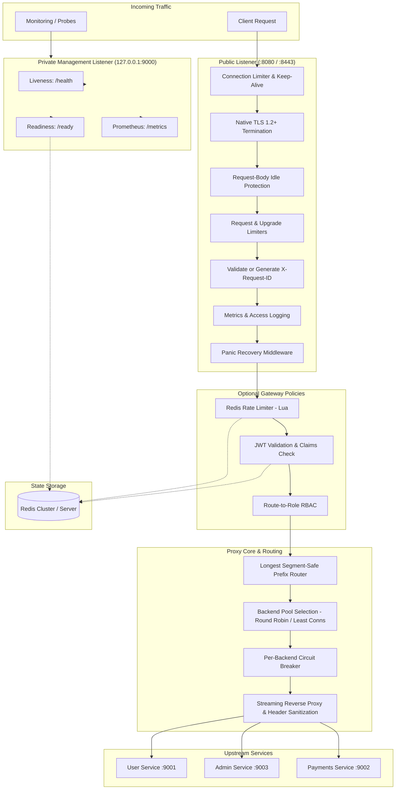

# SecureGate — High-Performance Go Reverse Proxy & API Gateway

[](https://go.dev/)
[](https://www.docker.com/)
[](https://prometheus.io/)
[](https://grafana.com/)
[](LICENSE)

SecureGate is a lightweight, cloud-native reverse proxy and API gateway written in Go. It delivers bounded connection concurrency, zero-downtime routing reloads, backend load balancing with active health checks, circuit breakers, and native TLS termination.

SecureGate operates in two distinct modes: as a **high-performance, standalone reverse proxy** (with zero external dependencies) or as a **hardened API gateway** featuring atomic Redis-backed rate limiting, JWT token validation, and segment-safe Role-Based Access Control (RBAC).

---

## Table of Contents

- [Overview & Problem Statement](#overview--problem-statement)
- [Key Features](#key-features)
- [Why Choose SecureGate?](#why-choose-securegate)
- [Quick Start](#quick-start)
  - [Option A: One-Command Host Demo](#option-a-one-command-host-demo-make-demo)
  - [Option B: 100% Containerized Demo](#option-b-100-containerized-demo-make-docker-demo)
- [Operating Modes](#operating-modes)
- [System Architecture & Request Lifecycle](#system-architecture--request-lifecycle)
  - [Architecture Flowchart](#architecture-flowchart)
  - [Request Lifecycle](#request-lifecycle)
  - [Segment-Safe Routing & URL Path Rewriting](#segment-safe-routing--url-path-rewriting)
- [Installation & Local Setup](#installation--local-setup)
  - [Prerequisites](#prerequisites)
  - [Step-by-Step Local Setup](#step-by-step-local-setup)
  - [Docker Container Build](#docker-container-build)
  - [Pre-compiled Release Binaries](#pre-compiled-release-binaries)
- [Configuration Reference](#configuration-reference)
  - [Pre-flight Validation (check-config)](#pre-flight-validation-check-config)
  - [Core Environment Variables](#core-environment-variables)
  - [Resource & Admission Limits](#resource--admission-limits)
  - [Redis Operation Limits](#redis-operation-limits)
  - [Dynamic Routes & Backend Pools (ROUTES_FILE)](#dynamic-routes--backend-pools-routes_file)
- [Security & Public Listener Hardening](#security--public-listener-hardening)
  - [Native TLS Termination](#native-tls-termination)
  - [Trusted Proxies & Safe Client IP Traversal](#trusted-proxies--safe-client-ip-traversal)
  - [Request ID Tracking & Correlation](#request-id-tracking--correlation)
  - [Panic Recovery & Admission Control](#panic-recovery--admission-control)
- [Authentication, RBAC & Token Management](#authentication-rbac--token-management)
  - [Generating JWT Tokens](#generating-jwt-tokens)
  - [Token Claims & Validation Rules](#token-claims--validation-rules)
  - [Route-to-Role Permission Map](#route-to-role-permission-map)
  - [Token Revocation](#token-revocation)
- [Management & Observability](#management--observability)
  - [Isolated Management Listener](#isolated-management-listener)
  - [Health & Readiness Probes](#health--readiness-probes)
  - [Prometheus Operational Metrics](#prometheus-operational-metrics)
  - [Auto-Provisioned Grafana Dashboard](#auto-provisioned-grafana-dashboard)
  - [Structured Access Logging](#structured-access-logging)
- [Error Handling & Client Retry Guide](#error-handling--client-retry-guide)
  - [Standardized JSON Error Envelope](#standardized-json-error-envelope)
  - [Status Codes & Client Retry Behavior](#status-codes--client-retry-behavior)
  - [Upstream Retry Policy](#upstream-retry-policy)
- [Comparative Nginx Benchmarking](#comparative-nginx-benchmarking)
- [Testing & Quality Assurance](#testing--quality-assurance)
- [Project Structure & Contributing](#project-structure--contributing)
  - [Directory Structure](#directory-structure)
  - [Makefile Targets Cheat Sheet](#makefile-targets-cheat-sheet)
  - [Contributing Guidelines](#contributing-guidelines)
- [Troubleshooting & FAQ](#troubleshooting--faq)
- [License](#license)

---

## Overview & Problem Statement

Modern microservice architectures face a dilemma when selecting edge routing infrastructure:

1. **Heavyweight API Gateways** (such as Kong, Apisix, or Envoy-based meshes) often require complex control planes, external databases, Lua/Wasm runtimes, and significant CPU/memory overhead.
2. **Traditional Web Servers** (such as Nginx or HAProxy) require custom C/Lua modules for dynamic JWT validation, lack integrated circuit breaking out-of-the-box, and require separate tooling for structured Prometheus telemetry.
3. **Ad-hoc Custom Proxies** built with basic standard-library handlers often suffer from goroutine leaks under slowloris attacks, unbounded connection growth, and missing connection draining.

**SecureGate bridges this gap.** It delivers a single, statically compiled Go binary that operates either as an ultra-fast reverse proxy or as a secure API gateway. It includes production-grade resource bounding, circuit breaking, active health checking, zero-downtime routing reloads, and Prometheus observability with zero external runtime dependencies when run in proxy-only mode.

---

## Key Features

| Capability | Details |
|---|---|
| **One-Command Demo** | Spin up the gateway, Redis, 3 backend services, Prometheus, and Grafana in seconds (`make demo` or `make docker-demo`). |
| **Config Pre-flight Validation** | Strict configuration and route checker (`make check-config` or `-t`) validating syntax and files without binding ports. |
| **Zero-Downtime Reloads** | Atomic routing swaps via `SIGHUP` preserving in-flight requests and background workers. |
| **Dynamic Backend Pools** | Load balance across pools using `round_robin` or `least_connections` algorithms with reload draining. |
| **Active Health Checks** | Periodic background probes (`GET /health`) actively evict degraded upstream instances before clients fail. |
| **Circuit Breakers** | Per-backend state machine (`CLOSED` → `OPEN` → `HALF_OPEN`) failing fast with `503` and `Retry-After: 30`. |
| **Native TLS Termination** | Public HTTPS listener enforcing TLS 1.2+, modern curves (`X25519`, `P256`), and ALPN (`h2`, `http/1.1`). |
| **Trusted Proxy Traversal** | Canonical CIDR allowlists with right-to-left `X-Forwarded-For` traversal, dual-stack `::ffff:` unmapping, and header stripping. |
| **JWT Authentication** | Secure HMAC-SHA256 (`HS256`) enforcement verifying `iss`, `aud`, `exp`, and unique non-empty `jti` IDs. |
| **Segment-Safe RBAC** | Path-segment routing (`USER` vs. `ADMIN`) preventing URI traversal and mount bypasses. |
| **Atomic Redis Rate Limiting**| Sliding-window Lua rate limiter per client IP returning `429 Too Many Requests` with `Retry-After` headers. |
| **Isolated Management API** | Private listener on `127.0.0.1:9000` exposing liveness (`/health`), Redis readiness (`/ready`), and Prometheus (`/metrics`). |
| **Prometheus & Grafana** | 15 operational metrics with pre-configured Prometheus scrape profiles and an auto-provisioned Grafana dashboard. |
| **Standardized JSON Errors** | Consistent error envelopes (`code`, `message`, `status`, `request_id`) across all middleware and gateway errors. |
| **Resource & Socket Bounding**| Configurable connection limits, request limits, upgrade limits, header caps, and upload body idle timeouts. |
| **Panic & Abort Safety** | Recovers from unexpected panics with clean `500` JSON errors before commit; safely aborts partial writes. |
| **Nginx Comparison Suite** | Built-in benchmarking engine (`cmd/benchmark`) and isolated Compose stack for direct comparisons against Nginx. |
| **Minimal Docker Runtime** | Static Go binary running on `scratch` as non-root user `65532:65532`. |
| **Release Automation** | Cross-compiles versioned binaries for Linux/macOS (amd64/arm64) with cryptographic `SHA256SUMS`. |

---

## Why Choose SecureGate?

### Comparison Matrix

| Feature / Attribute | SecureGate | Nginx (Open Source) | Envoy Proxy | Traefik |
|---|---|---|---|---|
| **Binary & Architecture** | Single static Go binary | C binary with process master/workers | C++ complex event-driven | Go binary |
| **Memory Footprint** | ~15–30 MB RSS | ~5–10 MB RSS | ~50–150 MB RSS | ~40–80 MB RSS |
| **Configuration Model** | Environment variables + JSON routes | Custom `.conf` scripting syntax | Extensive YAML / xDS v3 API | YAML / TOML / Docker labels |
| **Zero-Downtime Reload** | ✅ Atomic `SIGHUP` (handler swap + draining) | ✅ Process reload (`nginx -s reload`) | ✅ xDS dynamic API streaming | ✅ Dynamic file / provider watcher |
| **Circuit Breakers** | ✅ Built-in per-backend state machine | ❌ Requires Nginx Plus or Lua | ✅ Built-in outlier detection | ✅ Built-in middleware |
| **Rate Limiting** | ✅ Built-in atomic Redis Lua script | ⚠️ Local memory zone only (no cluster) | ✅ Requires external RateLimit service | ⚠️ Local memory / Redis plugin |
| **JWT & RBAC** | ✅ Built-in HS256 claims validation | ❌ Requires Nginx Plus or OpenResty | ✅ Built-in filter | ⚠️ Requires Traefik Enterprise / plugin |
| **Prometheus Telemetry**| ✅ 15 native metrics on isolated listener | ❌ Requires stub_status + exporter | ✅ Built-in extensive stats | ✅ Native metrics endpoint |
| **Control Plane Needed**| ❌ No | ❌ No | ⚠️ Often requires Istio/Control Plane | ❌ No |

### When to Use SecureGate
- **Microservices & API Edges:** When you need a fast, unified gateway that handles JWT auth, RBAC, Redis rate limiting, and circuit breaking in a single container.
- **Go Ecosystems:** Perfect for teams that want an inspectable, testable, pure Go reverse proxy without dealing with Lua plugins or C module compilation.
- **Docker & Kubernetes Deployments:** Deploys instantly as a minimal ~25 MB scratch image with pre-configured health and readiness probes.

### When NOT to Use SecureGate
- **Complex Service Mesh:** If you require dynamic mTLS mesh control planes across thousands of services, consider Envoy or Istio.
- **Raw Static File Caching:** If your primary need is serving terabytes of static media or byte-range disk caching, raw Nginx is purpose-built for that.

---

## Quick Start

Experience the full SecureGate stack in under 2 minutes.

### Option A: One-Command Host Demo (`make demo`)

If you have Go and Docker installed, run:

```bash
make demo
```

This single command automatically:
1. Starts Redis, Prometheus, and Grafana in Docker.
2. Launches three sample upstream services: `userservice` (:9001), `adminservice` (:9003), and `paymentsservice` (:9002).
3. Starts the SecureGate gateway on port `8080` (with management on `127.0.0.1:9000`).
4. Generates demo `USER` and `ADMIN` JWT tokens and outputs ready-to-run curl commands.
5. Pre-provisions Grafana at `http://localhost:3000/d/securegate-overview`.
6. Gracefully terminates all background services when you press `Ctrl+C`.

### Option B: 100% Containerized Demo (`make docker-demo`)

To run the entire ecosystem in isolated Docker containers without installing Go locally:

```bash
make docker-demo
# or: docker compose -f docker-compose.demo.yml up
```

### Instant Verification

Open a new terminal and execute requests against the running gateway:

```bash
# 1. Check management health & readiness
curl http://localhost:9000/health
# Output: {"status":"ok"}

curl http://localhost:9000/ready
# Output: {"status":"ok","redis":"ok"}

# 2. Generate a valid test JWT token
USER_TOKEN=$(make token | tail -n 1)

# 3. Call a protected route through the gateway
curl -i -H "Authorization: Bearer ${USER_TOKEN}" http://localhost:8080/users/hello
# HTTP/1.1 200 OK
# Output: hello for user service

# 4. View Prometheus metrics
curl http://localhost:9000/metrics | grep securegate_requests_total
```

---

## Operating Modes

SecureGate supports two operational modes based on your requirements:

### Mode 1: High-Performance Standalone Proxy (Zero Dependencies)
In standalone mode, SecureGate operates purely as a high-throughput, streaming reverse proxy. It does **not** connect to Redis, does not require a `JWT_SECRET`, and reports readiness with `{"status":"ok","redis":"disabled"}`.

To enable standalone proxy mode, set:
```env
AUTH_ENABLED=false
RATE_LIMIT_ENABLED=false
```

### Mode 2: Fully Protected API Gateway (Default)
In gateway mode, SecureGate acts as an enterprise edge gateway. Every incoming request passes through admission bounding, JWT verification, RBAC permissions, atomic sliding-window rate limiting, and upstream circuit breakers.
- Requires: A reachable Redis instance (`REDIS_ADDR`) and a strong `JWT_SECRET`.

---

## System Architecture & Request Lifecycle

### Architecture Flowchart



### Request Lifecycle

1. **Connection Admission:** The TCP socket is accepted. If active sockets exceed `MAX_CONNECTIONS`, the connection is closed.
2. **TLS Termination (Optional):** Handshake completes using configured certificates, enforcing TLS 1.2+ and negotiating ALPN (`h2` or `http/1.1`).
3. **Idle Protection & Request Admission:** Body reads are wrapped with `CLIENT_READ_IDLE_SECONDS`. Concurrency is bounded by `MAX_REQUESTS` (or `MAX_UPGRADE_REQUESTS` for WebSockets).
4. **Request ID Correlation:** Incoming `X-Request-ID` is sanitized (alphanumeric, `.`, `_`, `:`, `-`). If missing or invalid, an 8-character cryptographically random ID is generated.
5. **Observability & Recovery:** Request timers start, metrics counters are armed, and panic recovery is initialized.
6. **Policy Evaluation (If Enabled):**
   - **Rate Limiting:** Client IP is extracted via trusted proxy policy. Atomic Redis Lua script checks current count against `RATE_LIMIT_COUNT` within `RATE_LIMIT_WINDOW_SECONDS`.
   - **Authentication:** `Authorization: Bearer <token>` is parsed, signature verified, and revocation status checked in Redis.
   - **RBAC:** Token `role` is verified against the route's required role.
7. **Routing & Backend Selection:** The longest segment-safe prefix is matched. For multi-backend pools, the algorithm (`round_robin` or `least_connections`) selects an active, healthy backend whose circuit breaker is not `OPEN`.
8. **Upstream Forwarding:** The request is streamed upstream. Forwarding headers (`X-Forwarded-For`, `X-Real-IP`, `X-Forwarded-Proto`, `X-Forwarded-Host`) are securely set, and spoofable headers (`Forwarded`, `X-Forwarded-Port`) are purged.

### Segment-Safe Routing & URL Path Rewriting

Routing matches strictly on decoded path segments:
- Mount `/users` matches `/users`, `/users/`, and `/users/profile`.
- Mount `/users` **never** matches `/usersanything` or `/users-service`.
- Encoded mounts are handled safely: `/%75sers%2Fa%2Fb` decodes and forwards as `/a%2Fb`.

**Path Stripping:** The route prefix and its separating slash are stripped before forwarding:
- Route: `/users` → Upstream: `http://localhost:9001`
- Request: `http://localhost:8080/users/profile?tab=info`
- Upstream Receives: `http://localhost:9001/profile?tab=info`
- Escapes are preserved: `/users/a%2Fb` reaches upstream as `/a%2Fb` (not decoded into `/a/b`).

---

## Installation & Local Setup

### Prerequisites
- **Go:** Version `1.25.6` or newer.
- **Docker & Docker Compose:** For running Redis, Prometheus, Grafana, or the containerized stack.
- **curl & make:** Standard Unix utilities.

### Step-by-Step Local Setup

1. **Clone the repository:**
   ```bash
   git clone https://github.com/whilstsomebody/securegate.git
   cd securegate
   ```

2. **Configure environment variables:**
   Create a `.env` file in the project root:
   ```env
   JWT_SECRET=super_secret_development_key_change_in_production
   REDIS_ADDR=127.0.0.1:6379
   GATEWAY_PORT=:8080
   MANAGEMENT_ADDR=127.0.0.1:9000
   ```

3. **Validate configuration:**
   ```bash
   make check-config
   ```

4. **Start Redis:**
   ```bash
   docker compose up -d redis
   # Redis is published on 127.0.0.1:6379
   ```

5. **Start sample backend services:**
   ```bash
   make services
   # Starts userservice (:9001), adminservice (:9003), paymentsservice (:9002) in the background
   ```

6. **Run SecureGate:**
   ```bash
   make run
   # Or build binary: make build && ./bin/gateway
   ```

### Docker Container Build

SecureGate compiles into a hardened, non-root `scratch` container containing only the static binary and root CA certificates:

```bash
# Build the Docker image
docker build -t securegate:latest .

# Print version from container
docker run --rm securegate:latest -version

# Pre-flight check configuration inside container
docker run --rm -e JWT_SECRET=test-secret securegate:latest -check-config
```

### Pre-compiled Release Binaries

Generate cross-compiled binaries with Git commit tags, build timestamps, and SHA256 checksums:

```bash
make release VERSION=v0.2.0
```
Artifacts are generated in `bin/release/`:
- `securegate-v0.2.0-linux-amd64`
- `securegate-v0.2.0-linux-arm64`
- `securegate-v0.2.0-darwin-amd64`
- `securegate-v0.2.0-darwin-arm64`
- `SHA256SUMS`

---

## Configuration Reference

### Pre-flight Validation (`check-config`)

Never deploy a broken configuration to production. Validate environment variables, resource bounds, file permissions, and route schemas before opening network sockets:

```bash
# Via makefile:
make check-config

# Via gateway binary flags:
./bin/gateway -check-config
./bin/gateway -t
./bin/gateway check-config
```

Example output of a valid configuration:
```text
configuration is valid (SecureGate v0.2.0-dev (commit: a1b2c3d, built: 2026-10-22, go: go1.26.6))

Configuration syntax and values:
  Gateway Listen:       :8080
  TLS Termination:      false
  Management Listen:    127.0.0.1:9000
  Redis Address:        127.0.0.1:6379
  Redis Required:       true
  Access Logging:       false
  Trusted Proxies:      10.0.0.0/8, 192.168.0.0/16
  Route Source:         legacy environment variables
  Routes:
    /users -> http://localhost:9001 (balance: round_robin, role: USER)
    /admin -> http://localhost:9003 (balance: round_robin, role: ADMIN)
    /payments -> http://localhost:9002 (balance: round_robin, role: ADMIN)
  Rate Limiting:        enabled=true (5 requests / 10s per client IP)
  JWT Policy:           enabled=true issuer="securegate" audience="securegate-api" (secret configured: true)
  Resource Limits:
    Max Connections:    1024
    Max Requests:       256 (upgrades: 32)
    Max Upstream Conns: 128
    Max Header Bytes:   65536 bytes
    Timeouts:
      Header Timeout:   5s
      Request Timeout:  30s
      Client Read Idle: 30s
      Client Write:     30s
      Keep-Alive Idle:  1m0s
      Upstream Dial:    5s
      Upstream Header:  15s
      Upstream Read:    1m0s
      Shutdown Budget:  10s
```

### Core Environment Variables

| Variable | Default | Description |
|---|---|---|
| `JWT_SECRET` | *(required if auth enabled)* | HMAC-SHA256 secret key for signing and verifying tokens. |
| `JWT_ISSUER` | `securegate` | Expected token issuer (`iss`), exact string match. |
| `JWT_AUDIENCE` | `securegate-api` | Expected token audience (`aud`), string or array entry. |
| `AUTH_ENABLED` | `true` | Enables JWT validation, revocation checking, and RBAC middleware. |
| `REDIS_ADDR` | `127.0.0.1:6379` | Redis `host:port` address (required if auth or rate limiting is enabled). |
| `RATE_LIMIT_ENABLED` | `true` | Enables atomic Redis-backed client-IP sliding-window rate limiting. |
| `RATE_LIMIT_COUNT` | `5` | Maximum requests allowed per window per client IP. |
| `RATE_LIMIT_WINDOW_SECONDS` | `10` | Rate limit sliding window size in seconds (1–9223372036). |
| `ROUTES_FILE` | *(unset)* | Path to dynamic JSON routes file (replaces legacy static addresses; reloadable). |
| `USER_SERVICE_ADDR` | `http://localhost:9001` | Legacy `/users` upstream base URL (used only when `ROUTES_FILE` is unset). |
| `ADMIN_SERVICE_ADDR` | `http://localhost:9003` | Legacy `/admin` upstream base URL (used only when `ROUTES_FILE` is unset). |
| `PAYMENTS_SERVICE_ADDR` | `http://localhost:9002` | Legacy `/payments` upstream base URL (used only when `ROUTES_FILE` is unset). |
| `ACCESS_LOG_ENABLED` | `false` | Enables synchronous JSON per-request access logs. |
| `TRUSTED_PROXY_CIDRS` | *(unset)* | Comma-separated canonical CIDRs allowed to supply forwarding headers. |
| `TLS_CERT_FILE` | *(unset)* | Path to PEM certificate chain for HTTPS listener. |
| `TLS_KEY_FILE` | *(unset)* | Path to PEM private key for HTTPS listener. |
| `MANAGEMENT_ADDR` | `127.0.0.1:9000` | Private listener for `/health`, `/ready`, and `/metrics`. |
| `GATEWAY_PORT` | `:8080` | Public listener address (`:port` or `host:port`). |

### Resource & Admission Limits

Configured at startup to bound resource consumption and prevent resource exhaustion attacks:

| Setting | Default | Description |
|---|---|---|
| `MAX_CONNECTIONS` | `1024` | Total concurrent client TCP sockets accepted on public listener. |
| `MAX_REQUESTS` | `256` | Maximum concurrent in-flight requests processed by the pipeline. |
| `MAX_UPGRADE_REQUESTS` | `32` | Dedicated subset budget for hijacked connections (e.g. WebSockets). |
| `MAX_UPSTREAM_CONNECTIONS` | `128` | Connection pool limit per unique upstream host. |
| `MAX_HEADER_BYTES` | `65536` | Maximum allowed request and response header size (64 KB). |
| `HEADER_TIMEOUT_SECONDS` | `5` | Maximum duration allowed for client to transmit complete headers. |
| `REQUEST_TIMEOUT_SECONDS` | `30` | Total request deadline including body read. Set to `0` for indefinite streaming/uploads. |
| `CLIENT_READ_IDLE_SECONDS` | `30` | Maximum wait between individual client request body read chunks. |
| `CLIENT_WRITE_TIMEOUT_SECONDS` | `30` | Maximum wait for client socket write operations. |
| `KEEPALIVE_TIMEOUT_SECONDS` | `60` | HTTP keep-alive connection idle duration. |
| `UPSTREAM_DIAL_TIMEOUT_SECONDS` | `5` | Upstream TCP socket dial and handshake timeout. |
| `UPSTREAM_HEADER_TIMEOUT_SECONDS`| `15` | Maximum wait for upstream service to return response headers. |
| `UPSTREAM_READ_IDLE_SECONDS` | `60` | Maximum wait between individual upstream body read chunks. |
| `SHUTDOWN_TIMEOUT_SECONDS` | `10` | Graceful shutdown budget for in-flight requests before hard exit. |

### Redis Operation Limits
- **Operation Timeouts:** Every Redis command (`AllowRequest`, revocation check, ping) inherits the request context with a strict **500 ms** timeout.
- **Connection Bounds:** Connection pool is capped at **32 connections** with a **100 ms** acquisition deadline.
- **Fail-Closed Policy:** If Redis becomes unreachable, rate limiting fails closed (`503 Service Unavailable` with `Retry-After: 5`) to prevent unauthorized traffic spikes during outages.

### Dynamic Routes & Backend Pools (`ROUTES_FILE`)

Configure dynamic multi-backend pools and routing in a JSON document:

```json
{
  "routes": [
    {
      "prefix": "/catalog",
      "backends": [
        "http://catalog-srv-1:8080",
        "http://catalog-srv-2:8080"
      ],
      "balance": "least_connections",
      "health_check_path": "/healthz",
      "health_check_interval_seconds": 5,
      "role": "USER"
    },
    {
      "prefix": "/billing/v1",
      "target": "http://billing-srv:8080",
      "role": "ADMIN"
    }
  ]
}
```

#### Load Balancing Algorithms
- `round_robin` (Default): Distributes requests sequentially across healthy backends.
- `least_connections`: Routes each incoming request to the healthy backend currently handling the fewest active in-flight requests.

#### Active Health Checks
- Multi-backend pools automatically initialize background health checkers.
- Probes issue periodic HTTP `GET` requests to `health_check_path` (default `/health`).
- Responses with `2xx` or `3xx` status codes mark the backend healthy.
- Unhealthy backends and backends with open circuit breakers are immediately removed from selection.

#### Zero-Downtime Reload via SIGHUP
To reload routes without dropping a single in-flight request:
```bash
# 1. Update routes.json atomically
cp new_routes.json /etc/securegate/routes.json

# 2. Send SIGHUP to the running gateway
kill -HUP $(pgrep gateway)
```
- SecureGate validates the file completely. If invalid, the reload aborts, an error is logged, and existing routes remain active.
- If valid, the new routing table is swapped atomically.
- Existing in-flight requests complete on their assigned backend pools. The old pools gracefully drain and stop background health workers once active requests reach zero.

---

## Security & Public Listener Hardening

### Native TLS Termination
SecureGate provides native TLS termination with modern cryptography standards:
```env
TLS_CERT_FILE=/etc/securegate/tls/fullchain.pem
TLS_KEY_FILE=/etc/securegate/tls/privkey.pem
GATEWAY_PORT=:8443
```
- **TLS 1.2+ Enforcement:** TLS 1.0 and 1.1 are permanently disabled.
- **Modern Curves:** Optimized for `CurveX25519` and `CurveP256`.
- **ALPN Support:** Advertises both HTTP/2 (`h2`) and HTTP/1.1 (`http/1.1`).
- **Scheme Forwarding:** Automatically injects `X-Forwarded-Proto: https` into upstream requests.
- The management listener (:9000) intentionally remains plain HTTP on the internal loopback.

### Trusted Proxies & Safe Client IP Traversal

When running behind reverse proxies or load balancers (such as AWS ALB, Cloudflare, or Kubernetes Ingress), client IPs must be extracted safely to prevent IP spoofing:

```env
TRUSTED_PROXY_CIDRS=10.0.0.0/8,192.168.0.0/16,172.16.0.0/12
```

- **Untrusted Peers (Default):** Incoming `X-Forwarded-For`, `X-Real-IP`, and `Forwarded` headers are completely stripped. The direct TCP peer IP is used for rate limiting and outbound `X-Real-IP`.
- **Trusted Peers:** If the direct peer matches `TRUSTED_PROXY_CIDRS`, SecureGate parses `X-Forwarded-For` from **right to left**, skipping trusted proxy hops until it finds the first untrusted IP. That address is verified as the true client.
- **Dual-Stack IPv4-in-IPv6:** IPv4-mapped IPv6 addresses (e.g. `::ffff:10.1.2.3`) are automatically unmapped and normalized to IPv4 `10.1.2.3`.
- **Sanitized Headers:** SecureGate rebuilds a clean upstream `X-Forwarded-For` chain containing the verified client plus all trusted hops. Spoofed headers (`Forwarded`, `X-Forwarded-Port`) are purged.

### Request ID Tracking & Correlation
- Incoming `X-Request-ID` headers are validated against strict criteria (1–128 ASCII alphanumeric and `.`, `_`, `:`, `-`).
- Invalid, missing, or spoofed IDs are stripped and replaced with an 8-character cryptographically random ID.
- The request ID is echoed in the response header and embedded in all JSON error envelopes and structured logs.

### Panic Recovery & Admission Control
- Any unexpected panic inside middleware or proxy logic is intercepted by `RecoveryMiddleware`.
- If the response headers have not yet been committed, SecureGate writes a standardized `500 INTERNAL_SERVER_ERROR` JSON envelope.
- If headers were already committed, the response cleanly aborts (`http.ErrAbortHandler`) without leaking internal stack traces or corrupting payload streams.

---

## Authentication, RBAC & Token Management

### Generating JWT Tokens
Use the bundled CLI tool to generate valid HMAC-SHA256 (`HS256`) tokens:

```bash
# Generate a standard USER token
make token

# Generate an elevated ADMIN token
make token ROLE=ADMIN

# Inspect custom token generator flags
go run ./cmd/token -help
```

### Token Claims & Validation Rules
Every token presented to the gateway must satisfy:
1. **Algorithm:** Must use `HS256` signed with `JWT_SECRET`.
2. **Expiration (`exp`):** Required; expired tokens return `401 INVALID_OR_EXPIRED_TOKEN`.
3. **Issuer (`iss`):** Must exactly match `JWT_ISSUER` (default: `securegate`).
4. **Audience (`aud`):** Must match `JWT_AUDIENCE` (default: `securegate-api`).
5. **Token ID (`jti`):** Must be a non-empty string.
6. **Role (`role`):** Must contain a recognized role (`USER` or `ADMIN`).

### Route-to-Role Permission Map

| Path Prefix | Required Role | Default Upstream | Access Policy |
|---|---|---|---|
| `/users` and `/users/...` | `USER` | `http://localhost:9001` | Accessible by `USER` and `ADMIN` tokens |
| `/admin` and `/admin/...` | `ADMIN` | `http://localhost:9003` | Accessible **only** by `ADMIN` tokens |
| `/payments` and `/payments/...` | `ADMIN` | `http://localhost:9002` | Accessible **only** by `ADMIN` tokens |
| `/metrics` | *(none)* | Management Listener | Blocked on public listener (`404`) |
| `/health` | *(none)* | Management Listener | Blocked on public listener (`404`) |
| `/ready` | *(none)* | Management Listener | Blocked on public listener (`404`) |

### Token Revocation
The public `/auth/revoke` endpoint has been retired and returns `404 Not Found`. Token issuance and revocation writes belong to your dedicated authentication service. Existing revocation records stored in Redis (keyed by token `jti`) remain strictly enforced by SecureGate; revoked tokens are rejected with `401 REVOKED_TOKEN`.

---

## Management & Observability

### Isolated Management Listener
SecureGate isolates internal operations from public exposure by serving management APIs on a dedicated listener (`MANAGEMENT_ADDR`, default `127.0.0.1:9000`):
- Public listener requests to `/health`, `/ready`, or `/metrics` return `404 Not Found`.
- The management listener has separate socket budgets (32 sockets, 8 requests) preventing public traffic spikes from starving health checks.

### Health & Readiness Probes

```bash
# 1. Process Liveness (Never calls external dependencies)
curl http://127.0.0.1:9000/health
# Response: {"status":"ok"}

# 2. Redis Readiness Probe (Checks Redis within 500 ms)
curl http://127.0.0.1:9000/ready
# Response: {"status":"ok","redis":"ok"}
```

### Prometheus Operational Metrics

Scrape operational metrics at `http://127.0.0.1:9000/metrics`.

| Metric Name | Type | Labels | Description |
|---|---|---|---|
| `securegate_requests_total` | Counter | `path`, `method`, `status` | Total requests processed across the pipeline. |
| `securegate_request_duration_seconds` | Histogram | `path` | End-to-end request duration distribution. |
| `securegate_rate_limited_total` | Counter | `path` | Total requests rejected by rate limiting (`429`). |
| `securegate_auth_failures_total` | Counter | `path`, `reason` | Authentication and authorization rejections. |
| `securegate_response_aborts_total` | Counter | `path` | Responses aborted or interrupted before completion. |
| `securegate_admission_rejections_total`| Counter | `reason` | Rejections due to concurrency caps (`request_limit`, `upgrade_limit`). |
| `securegate_active_connections` | Gauge | — | Current open client TCP sockets. |
| `securegate_active_requests` | Gauge | — | Current in-flight requests being served. |
| `securegate_active_upgrades` | Gauge | — | Current active upgraded/WebSocket connections. |
| `securegate_upstream_duration_seconds` | Histogram | `route` | Upstream network round-trip duration. |
| `securegate_timeouts_total` | Counter | `type` | Timeout occurrences (`upstream_dial`, `upstream_header`, etc.). |
| `securegate_circuit_breaker_state` | Gauge | `route`, `backend` | Breaker state: `0` = CLOSED, `1` = OPEN, `2` = HALF_OPEN. |
| `securegate_backend_healthy` | Gauge | `route`, `backend` | Active probe status: `1` = healthy, `0` = unhealthy. |
| `securegate_backend_active_requests` | Gauge | `route`, `backend` | Requests currently assigned to each backend. |
| `securegate_build_info` | Gauge | `version`, `commit`, `go_version` | Constant `1` exposing running build metadata. |

### Auto-Provisioned Grafana Dashboard

Running `make demo` or `make docker-up` provisions:
- **Prometheus UI:** `http://localhost:9090`
- **Grafana UI:** `http://localhost:3000/d/securegate-overview` (Anonymous admin access enabled)

**Dashboard Panels Included:**
- Request throughput and HTTP status code distribution
- P50, P95, and P99 latency percentiles (total vs. upstream)
- Active client connections, in-flight requests, and WebSockets
- Backend health status and active connection distribution
- Circuit breaker state indicators and rate-limit drops

### Structured Access Logging
Enable per-request JSON access logs by setting `ACCESS_LOG_ENABLED=true`:
```json
{"time":"2026-10-22T19:30:00Z","level":"INFO","msg":"request","method":"GET","route":"/users","status":200,"aborted":false,"duration_ms":4,"request_id":"c0a80105-1"}
```
- Route paths are normalized to avoid high-cardinality log explosion.
- Log record values are bounded at 1024 bytes.

---

## Error Handling & Client Retry Guide

### Standardized JSON Error Envelope
All error responses generated by SecureGate return a structured JSON body with `Content-Type: application/json; charset=utf-8`:

```json
{
  "error": {
    "code": "RATE_LIMIT_EXCEEDED",
    "message": "Rate limit exceeded",
    "status": 429,
    "request_id": "a1b2c3d4"
  }
}
```

### Status Codes & Client Retry Behavior

| Status Code | Cause | Injected Headers | Recommended Client Retry Behavior |
|---|---|---|---|
| `429 Too Many Requests` | Rate limit quota exhausted | `Retry-After: <seconds>` | Wait at least the duration in `Retry-After` before re-attempting. |
| `503 Service Unavailable` | Circuit breaker tripped (upstream down) | `Retry-After: 30` | Back off; wait 30 seconds for the breaker recovery probe. |
| `503 Service Unavailable` | Gateway concurrency limit (`Proxy busy`)| `Connection: close`, `Retry-After: 1` | Back off immediately with randomized exponential jitter. |
| `503 Service Unavailable` | Redis or authorization storage down | `Retry-After: 5` | Storage unavailable; retry after 5 seconds. |
| `502 Bad Gateway` | Upstream connection refused or timed out| `Content-Type: application/json` | Retry **only** for idempotent methods (GET, HEAD, PUT, DELETE). Non-idempotent requests (POST) should only retry if idempotency keys are supported. |
| `401 Unauthorized` | Missing, expired, or revoked JWT | `Content-Type: application/json` | Do not retry; obtain fresh credentials. |
| `403 Forbidden` | Insufficient RBAC role | `Content-Type: application/json` | Do not retry; token does not possess the required role. |

### Upstream Retry Policy
SecureGate deliberately does **not** transparently retry failed upstream requests. Transparent proxy retries can trigger thundering herd failures against struggling backend services and cause duplicate executions of non-idempotent operations (such as payment processing). Upstream resiliency is instead maintained using fast-failing circuit breakers.

---

## Comparative Nginx Benchmarking

SecureGate includes a reproducible benchmarking suite that executes identical workloads through SecureGate (in proxy-only mode) and Nginx against the same static upstream:

```bash
make benchmark
```

### How the Benchmark Works
- **Isolated Stack:** Starts a private Docker network containing a static upstream (`nginx:1.27-alpine`), proxy-only `securegate`, and `nginx`.
- **Alternating Rounds:** Target order alternates every round (`round % 2 == 1`) to eliminate warm-up and run-order bias.
- **Fair Concurrency:** The custom benchmark tool (`cmd/benchmark`) uses identical connection pools (`MaxConnsPerHost`, `MaxIdleConns`) for both targets.
- **Resource Sampling:** A background collector samples CPU, memory, network I/O, and block I/O once per second directly from the Docker daemon.

### Customizing Benchmark Parameters
```bash
BENCH_DURATION=30s BENCH_WARMUP=5s BENCH_CONCURRENCY=128 BENCH_ROUNDS=5 make benchmark
make benchmark-down
```

### Output Files
Results are saved to `benchmarks/results/`:
- `comparison.json`: Summarizes total requests, throughput (req/sec), errors, and p50/p95/p99 latency percentiles for both proxies.
- `resources.jsonl`: Raw once-per-second Docker stats for each container.

---

## Testing & Quality Assurance

SecureGate maintains extensive test coverage across unit, integration, and smoke test suites:

```bash
# 1. Run all unit tests with Go race detection
make test

# 2. Run real Redis integration tests (Requires Docker or local Redis)
make test-integration

# 3. Run operational smoke test suite
make smoke

# 4. Run live smoke test against a running gateway instance
make smoke-live

# 5. Run static analysis (go vet)
make lint

# 6. Validate Docker Compose configurations
docker compose config --quiet
docker compose -f docker-compose.demo.yml config --quiet
docker compose -f benchmarks/docker-compose.yml config --quiet
```

---

## Project Structure & Contributing

### Directory Structure

```text
SecureGate/
├── cmd/
│   ├── gateway/          # Gateway entrypoint (:8080 and management :9000)
│   ├── userservice/      # Sample user upstream service (port 9001)
│   ├── adminservice/     # Sample admin upstream service (port 9003)
│   ├── paymentsservice/  # Sample payments upstream service (port 9002)
│   ├── token/            # JWT token generator CLI
│   └── benchmark/        # Self-contained HTTP benchmark runner
├── benchmarks/           # Equal-workload Nginx comparison stack and configurations
├── internal/
│   ├── auth/             # JWT token parsing & validation helpers
│   ├── circuitbreaker/   # Thread-safe circuit breaker state machine
│   ├── config/           # Configuration parsing, bounds validation, and routes
│   ├── httpio/           # Standardized JSON errors, bounded buffers, recorders
│   ├── logging/          # Bounded structured slog handlers
│   ├── metrics/          # Prometheus metrics collectors and route labeling
│   ├── middlewares/      # Auth, rate limit, metrics, recovery, admission middlewares
│   ├── proxy/            # Reverse proxy core, backend pools, health checks, draining
│   ├── ratelimit/        # Atomic Redis Lua sliding window rate limiter
│   ├── routing/          # Segment-safe routing tables and prefix matching
│   ├── trustedproxy/     # CIDR validation and right-to-left XFF traversal
│   └── version/          # Version metadata and runtime build info
├── configs/
│   ├── grafana/          # Provisioned datasources and SecureGate Overview dashboard
│   ├── prometheus.yml    # Scrape configuration for development
│   └── prometheus.demo.yml # Scrape configuration for containerized demo
├── scripts/
│   ├── benchmark.sh      # Benchmark orchestration and Docker resource sampler
│   ├── demo.sh           # One-command host demo stack runner
│   ├── release.sh        # Multi-platform compilation and SHA256 checksums
│   └── smoke_test.sh     # Operational live smoke test runner
├── test/
│   ├── integration/      # Integration test suite against live Redis
│   └── smoke/            # End-to-end operational smoke tests
├── .github/workflows/
│   └── ci.yml            # GitHub Actions CI workflow
├── docker-compose.yml    # Local Redis, Prometheus, and Grafana stack
├── docker-compose.demo.yml # Full containerized demo environment
├── Dockerfile            # Minimal scratch runtime Dockerfile
└── Makefile              # Task automation and developer commands
```

### Makefile Targets Cheat Sheet

| Target | Description |
|---|---|
| `make demo` | Runs the full interactive stack demo on the local host. |
| `make docker-demo` | Starts all 7 services in isolated Docker containers. |
| `make check-config` | Validates configuration and resource limits syntax. |
| `make version` | Prints version, Git commit, build time, and Go version. |
| `make run` | Runs the gateway locally on `:8080`. |
| `make build` | Compiles gateway binary to `bin/gateway`. |
| `make test` | Runs all unit tests with race detection (`go test -race ./...`). |
| `make test-integration`| Runs tests against real Redis (`127.0.0.1:6379`). |
| `make smoke` | Executes end-to-end operational smoke tests. |
| `make smoke-live` | Runs live smoke shell script against active gateway. |
| `make release` | Cross-compiles versioned release binaries with `SHA256SUMS`. |
| `make benchmark` | Executes alternating comparison benchmarks against Nginx. |
| `make benchmark-down`| Tears down the benchmark Docker Compose stack. |
| `make lint` | Runs `go vet ./...`. |
| `make services` | Launches the three sample upstream microservices. |
| `make token` | Generates a test JWT (`ROLE=USER` by default, or `ROLE=ADMIN`). |
| `make docker-up` | Starts background Redis, Prometheus, and Grafana. |
| `make docker-down` | Stops and removes background containers. |

### Contributing Guidelines
1. **Fork & Branch:** Create a feature branch (`git checkout -b feature/my-enhancement`).
2. **Code Standards:** Maintain documentation integrity; ensure all code adheres to standard Go conventions (`gofmt`, `go vet`).
3. **Verify:** Ensure all tests pass with the race detector enabled:
   ```bash
   make lint && make test
   ```
4. **Pull Request:** Submit your PR with a clear description of the problem solved, design decisions, and test results.

---

## Troubleshooting & FAQ

### Common Issues & Solutions

#### 1. `Redis initialization failed` on startup
- **Cause:** `AUTH_ENABLED` or `RATE_LIMIT_ENABLED` is true, but Redis is not running at `REDIS_ADDR`.
- **Solution:** Start Redis with `docker compose up -d redis`, or switch to standalone proxy mode by setting `AUTH_ENABLED=false` and `RATE_LIMIT_ENABLED=false`.

#### 2. Requests return `401 INVALID_OR_EXPIRED_TOKEN`
- **Cause:** The JWT token has expired or was signed with a mismatched secret, issuer, or audience.
- **Solution:** Re-generate tokens using `make token` (or `make token ROLE=ADMIN`), ensuring your `JWT_SECRET`, `JWT_ISSUER`, and `JWT_AUDIENCE` match the gateway's settings.

#### 3. Requests return `503 SERVICE_UNAVAILABLE` with `Retry-After: 30`
- **Cause:** Upstream service failed 5 consecutive times, tripping the circuit breaker to `OPEN`.
- **Solution:** Check that upstream services are running (`make services`). The breaker will enter `HALF_OPEN` after 30 seconds and automatically reset upon the first successful probe.

#### 4. Requests return `429 RATE_LIMIT_EXCEEDED`
- **Cause:** More than `RATE_LIMIT_COUNT` requests were sent from your IP within `RATE_LIMIT_WINDOW_SECONDS`.
- **Solution:** Honor the `Retry-After` header. To increase allowances, raise `RATE_LIMIT_COUNT` in `.env`.

#### 5. SIGHUP reload fails or does not apply
- **Cause:** Syntax error or duplicate prefix inside `ROUTES_FILE`.
- **Solution:** Check logs (`slog.Error("route reload rejected", ...)`). SecureGate maintains active routes during reload errors to prevent outages. Run `gateway -check-config` to debug the route file.

---

## License

This project is licensed under the [MIT License](LICENSE).
